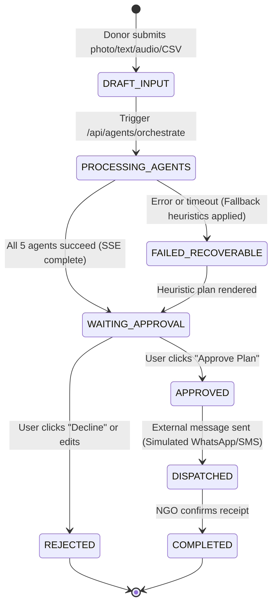

# Data Model: SurplusLink

This document defines the data structures, Firestore collections, BigQuery schemas, and entity relationships for SurplusLink.

---

## 1. Firestore Collections

### Collection: `donations`
Stores raw and extracted surplus food donations submitted by donors.
- Path: `/donations/{donationId}`
- Fields:
  - `id`: `string` (UUID or auto-generated ID)
  - `donorId`: `string` (Firebase Auth UID)
  - `donorName`: `string` (Restaurant, Mess, or Individual name)
  - `donorLocation`: `{ address: string, lat: number, lng: number }`
  - `createdAt`: `Timestamp`
  - `inputType`: `"TEXT" | "PHOTO" | "AUDIO" | "CSV" | "HYBRID"`
  - `rawInput`: `string` (Text description, OCR transcript, or audio transcript)
  - `imageUrl`?: `string`
  - `items`: `Array<{`
    - `id`: `string`
    - `name`: `string`
    - `category`: `"COOKED_GRAINS" | "COOKED_CURRY" | "RAW_VEGETABLES" | "BAKERY" | "DAIRY" | "PROTEIN_MEAT" | "OTHER"`
    - `quantityKg`: `number`
    - `cookedAt`: `Timestamp`
    - `storageCondition`: `"AMBIENT" | "REFRIGERATED" | "FROZEN" | "WARM_CONTAINER"`
    - `isPerishable`: `boolean`
  - `}>`
  - `status`: `"PENDING_ANALYSIS" | "ANALYZED" | "PLAN_GENERATED" | "DISPATCHED" | "CANCELLED"`

---

### Collection: `ngos`
Stores vetted non-governmental organizations and community kitchens.
- Path: `/ngos/{ngoId}`
- Fields:
  - `id`: `string`
  - `name`: `string`
  - `coordinatorName`: `string`
  - `contactPhone`: `string`
  - `email`: `string`
  - `address`: `string`
  - `location`: `{ lat: number, lng: number }`
  - `operatingHours`: `{ open: string, close: string }` (e.g. `"09:00"`, `"22:00"`)
  - `dailyCapacityKg`: `number` (e.g. `150`)
  - `currentOccupancyKg`: `number` (e.g. `45`)
  - `acceptedCategories`: `Array<string>` (e.g. `["COOKED_GRAINS", "COOKED_CURRY", "BAKERY"]`)
  - `acceptsNonVeg`: `boolean`
  - `hasColdStorage`: `boolean`
  - `verified`: `boolean`
  - `rating`: `number` (1.0 to 5.0)

---

### Collection: `plans`
Stores the multi-agent generated rescue plans awaiting human approval.
- Path: `/plans/{planId}`
- Fields:
  - `id`: `string`
  - `donationId`: `string`
  - `donorId`: `string`
  - `createdAt`: `Timestamp`
  - `safeUntil`: `Timestamp` (Earliest safe distribution limit)
  - `overallConfidence`: `number` (0.0 to 1.0)
  - `safetyNotes`: `string`
  - `verificationChecklist`: `string[]`
  - `quarantinedItems`: `Array<{ name: string, reason: string }>`
  - `matchedNgo`: `{`
    - `id`: `string`
    - `name`: `string`
    - `distanceKm`: `number`
    - `estimatedTravelMinutes`: `number`
    - `matchScore`: `number` (0.0 to 1.0)
    - `capacityAvailableKg`: `number`
  - `}`
  - `pickupWindow`: `{ start: Timestamp, end: Timestamp }`
  - `draftMessage`: `string` (Personalized, courteous dispatch communication in donor/NGO preferred language)
  - `status`: `"DRAFT_WAITING_APPROVAL" | "APPROVED" | "REJECTED" | "DISPATCHED" | "COMPLETED"`
  - `approvedAt`?: `Timestamp`
  - `approvedBy`?: `string`
  - `rejectionReason`?: `string`

---

### Collection: `auditLog`
Immutable trail recording every automated agent decision and human action.
- Path: `/auditLog/{logId}`
- Fields:
  - `id`: `string`
  - `timestamp`: `Timestamp`
  - `planId`?: `string`
  - `userId`: `string`
  - `userRole`: `"DONOR" | "NGO" | "ADMIN" | "SYSTEM_AGENT"`
  - `action`: `"AGENT_EXECUTION" | "PLAN_APPROVED" | "PLAN_REJECTED" | "DISPATCH_TRIGGERED" | "SECURITY_BLOCKED"`
  - `details`: `Record<string, any>`
  - `ipAddress`?: `string`

---

## 2. BigQuery Analytics Schema

- **Dataset**: `surpluslink_analytics`
- **Table**: `plan_metrics`

| Column Name | Type | Mode | Description |
|---|---|---|---|
| `plan_id` | STRING | REQUIRED | Unique plan identifier |
| `donor_id` | STRING | REQUIRED | Firebase Auth UID of donor |
| `timestamp` | TIMESTAMP | REQUIRED | ISO 8601 creation time |
| `food_category` | STRING | NULLABLE | Primary food category rescued |
| `total_weight_kg` | FLOAT64 | REQUIRED | Total edible weight routed |
| `meals_rescued` | INT64 | REQUIRED | Calculated as `total_weight_kg * 2.5` |
| `co2e_avoided_kg` | FLOAT64 | REQUIRED | Calculated as `total_weight_kg * 2.5` |
| `matched_ngo_id` | STRING | NULLABLE | ID of matched recipient NGO |
| `distance_km` | FLOAT64 | NULLABLE | Road distance between donor and NGO |
| `tokens_prompt` | INT64 | REQUIRED | Total input tokens across all 5 agents |
| `tokens_completion` | INT64 | REQUIRED | Total output tokens generated |
| `latency_ms` | INT64 | REQUIRED | Total pipeline wall-clock time in ms |
| `estimated_cost_usd` | FLOAT64 | REQUIRED | Computed cost based on Gemini pricing |
| `agent_success` | BOOL | REQUIRED | Whether pipeline succeeded without exception |
| `status` | STRING | REQUIRED | Current status (DRAFT, APPROVED, etc.) |

---

## 3. State Transition Diagram

